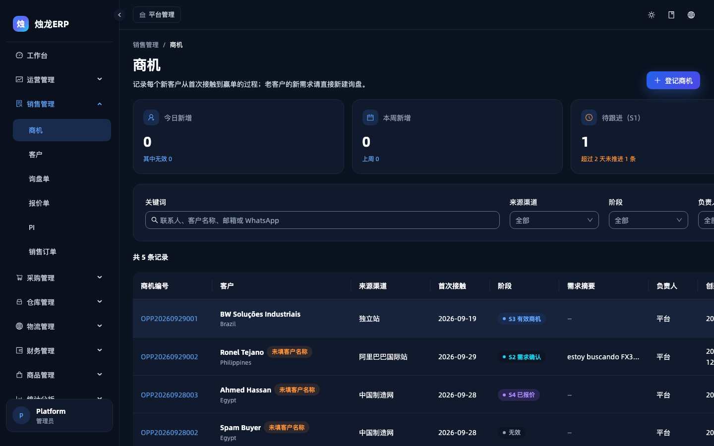
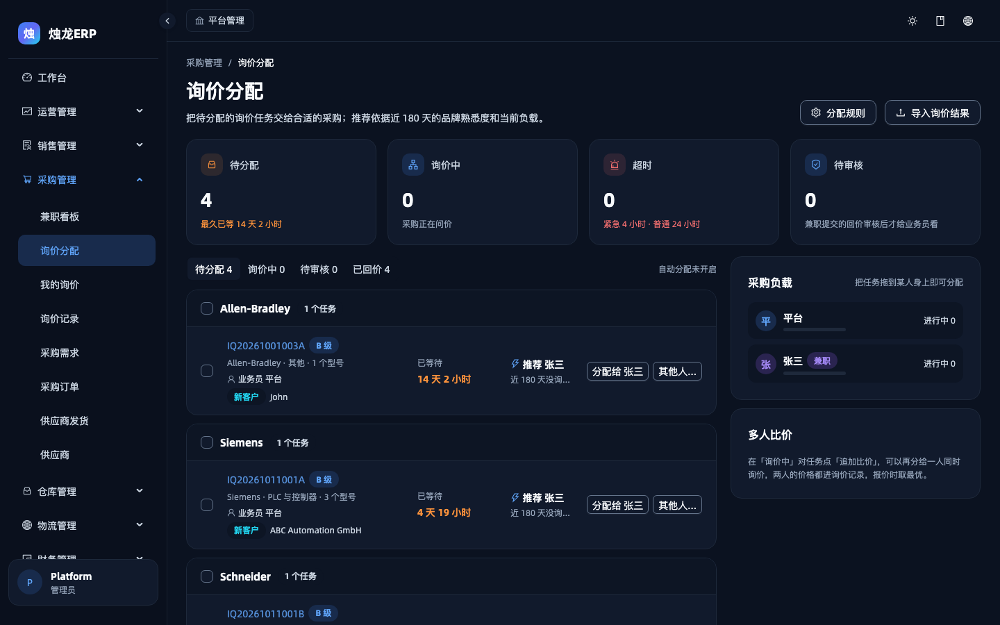
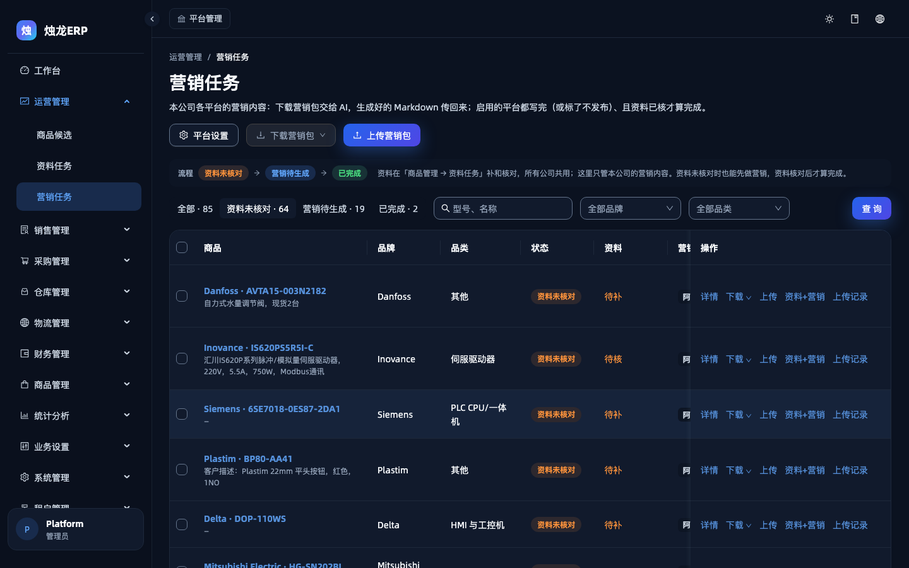
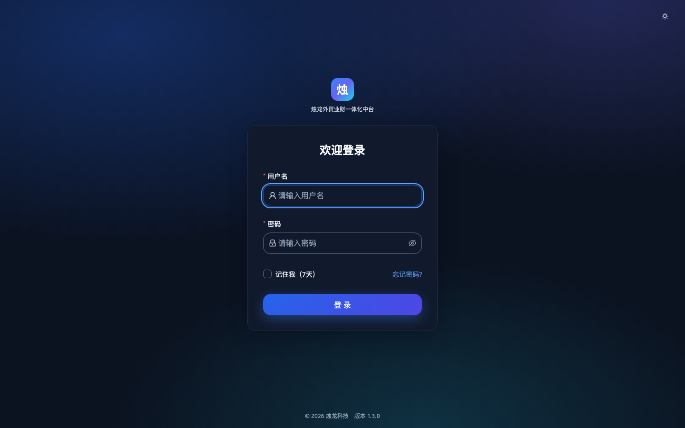
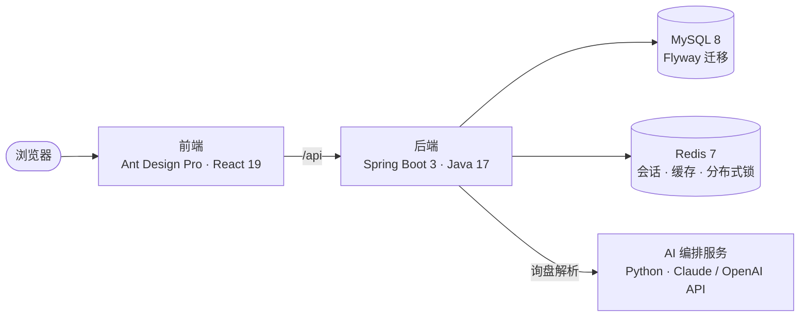
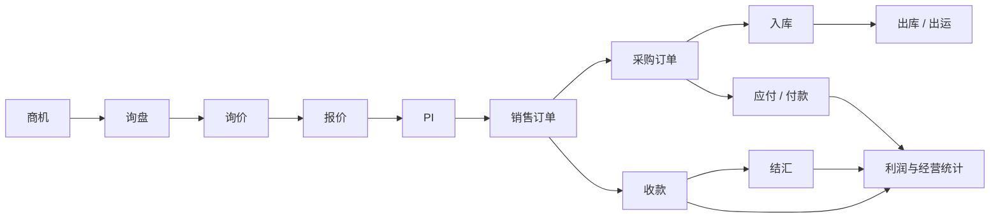

<div align="center">

# 烛龙 ERP

**面向工业品外贸企业的业财一体化中台**

从询盘到收款、从采购到结汇，业务每走一步，财务数据同步落账。

[](https://openjdk.org/projects/jdk/17/)
[](https://spring.io/projects/spring-boot)
[](https://react.dev)
[](https://ant.design)
[](https://www.mysql.com)
[](#-快速开始)
[](LICENSE)

[快速开始](#-快速开始) · [功能一览](#-功能一览) · [系统架构](#-系统架构) · [部署文档](docs/06-部署运维/README.md) · [路线图](#-路线图)

</div>

<p align="center">
  
</p>

## ✨ 为什么是烛龙 ERP

外贸团队常见的状态是：询盘在邮箱和 WhatsApp 里，报价在 Excel 里，采购在聊天记录里，财务月底再对一遍账。烛龙 ERP 把这些串成一条链路：

- **业财一体**：订单、采购、出运、收款、结汇、付款、费用都挂在同一条业务链上，利润和经营报表直接从业务单据算出来，不用月底再搬数据。
- **为工业品外贸设计**：围绕「品牌 + 型号」的询价、比价、砍价，现货与期货区分，阿里国际站和中国制造网的询盘渠道与客户等级，都是一线流程里长出来的。
- **AI 融进流程**：粘贴客户的邮件、聊天截图或 Excel，AI 识别型号并联网核对，按品牌和品类拆成询价任务；商品资料和各平台营销文案由 AI 生成后一键导入。
- **财务口径严格**：金额一律 `DECIMAL`，原币、汇率、本位币三值同存，按 `HALF_UP` 舍入；业务数据软删除，已锁定的凭证不可修改。
- **多租户 SaaS**：租户与套餐、按钮级权限、数据权限、租户级配置；商品主数据在全平台共享，业务数据按租户隔离。

## 📸 界面预览

<table>
  <tr>
    <td width="50%"></td>
    <td width="50%"></td>
  </tr>
  <tr>
    <td align="center"><b>询价分配</b>：按品牌熟悉度和负载推荐采购</td>
    <td align="center"><b>营销任务</b>：商品资料与各平台营销内容</td>
  </tr>
  <tr>
    <td width="50%"></td>
    <td width="50%"></td>
  </tr>
  <tr>
    <td align="center"><b>商机</b>：新客户从首次接触到赢单</td>
    <td align="center"><b>登录页</b>：站点名称、Logo、背景图可自定义</td>
  </tr>
</table>

## 🧭 功能一览

| 领域 | 功能 |
| --- | --- |
| **销售** | 商机（S1–S7 阶段、来源渠道、阿里等级）、客户、询盘单（AI 解析、追加型号）、报价单（多版本、议价测算）、PI、销售订单 |
| **采购** | 询价分配（按品牌熟悉度推荐、多人比价）、我的询价（支持 Excel 批量回价）、兼职看板与回价审核、询价记录、采购需求、采购订单、供应商发货、供应商 |
| **仓库** | 采购入库、销售出库、闲置库存、实拍任务 |
| **物流** | 出运单、运费账单 |
| **财务** | 收款单、退款单、结汇单（先进先出）、应付单、付款单（含私对私付款）、报销单、费用单、其他收入 |
| **商品** | 商品、品牌、品类、系列；商品资料（规格、证据、FAQ、公开挂牌参考价），全平台共享 |
| **运营** | 商品候选、资料任务、营销任务（阿里国际站、中国制造网、独立站、社媒） |
| **统计分析** | 销售统计、询价统计、砍价统计、利润统计、经营统计、商机统计 |
| **业务设置** | 定价策略、汇率、收款账户（对公 / 对私）、单据模板、编号规则、快递时效 |
| **平台** | 用户、角色、部门、岗位、菜单、字典、系统设置、操作日志、登录日志；租户与套餐 |

## 🏗 系统架构



业务主链路：



| 分类 | 技术选型 |
| --- | --- |
| 后端 | Spring Boot 3.2.5 · Java 17 · MyBatis-Plus 3.5.6 · Spring Security + JWT · Redisson · Flyway · Knife4j |
| 前端 | Ant Design Pro v6 · Umi Max v4 · antd 6 · ProComponents v3 · React 19 · Utoopack |
| 存储 | MySQL 8 · Redis 7 |
| AI | Python 编排服务 · Claude / OpenAI API |
| 工程 | Docker Compose · OpenSpec 规格驱动开发 · Biome · JUnit 5 |

## 🚀 快速开始

### 方式一：Docker 一键启动（推荐体验）

只需要安装 Docker：

```bash
git clone https://github.com/zhul-cloud/zhul-trade-erp.git
cd zhul-trade-erp
scripts/docker-dev.sh
```

Windows PowerShell：

```powershell
powershell -ExecutionPolicy Bypass -File scripts\docker-dev.ps1
```

脚本会生成 `.env`（随机密钥、导入演示账号），构建并启动 MySQL、Redis、后端、前端和 AI 编排服务。就绪后打开 <http://localhost:8000>，用下面的演示账号登录。默认不持久化，停止或重建容器后数据清空。

> 询盘的 AI 解析需要在系统里配置：登录后进入「业务设置 → AI 设置」，填写服务商（Claude 或 OpenAI）和 API Key，每个租户各自维护。脚本生成的 `.env` 默认 `AI_ORCHESTRATOR_MODE=stub`（假数据），要真实解析改成 `api`，见 [AI 编排服务](docs/06-部署运维/04-AI编排服务.md)。

### 方式二：本机开发

<details>
<summary><b>环境要求</b></summary>

| 依赖 | 版本 |
| --- | --- |
| JDK | 17 |
| Node.js | ≥ 20 |
| Maven | 3.9+ |
| MySQL | 8.0+ |
| Redis | 6+ |
| Docker（可选，用于启动 MySQL / Redis） | 最新稳定版 |

> **macOS + Homebrew 用户注意**：`brew install openjdk` 装的是最新版 JDK。如果同时装了 `openjdk@17`，`mvn` 可能用到新版 JDK，导致 Lombok 注解处理器静默失效（编译报大量「找不到符号」）。执行 Maven 前先 `export JAVA_HOME=$(brew --prefix openjdk@17)`。

</details>

```bash
# 1. 启动 MySQL 与 Redis（只建空库，表结构由后端启动时的 Flyway 自动创建）
docker compose up -d

# 2. 启动后端：http://localhost:8080，接口文档 /doc.html
cd zhul-erp-backend
cp src/main/resources/application-dev.yml.example src/main/resources/application-dev.yml
mvn spring-boot:run

# 3. 启动前端：http://localhost:8000，/api 已代理到 8080
cd ../zhul-erp-frontend
npm install
npm run dev
```

后端启动时 Flyway 会自动建表并导入菜单、内置角色、字典等结构性数据，以及 `application-dev.yml` 开启的演示账号，不需要手动执行 SQL。迁移脚本在 `db/migration`（所有环境执行）和 `db/dev-data`（仅本地开发）。

AI 编排服务的本机启动见 [部署场景 · 方式二](docs/06-部署运维/01-部署场景.md#方式二数据库用-docker前后端和-ai-编排在本机运行)。

### 演示账号

| 用户名 | 密码 | 说明 |
| --- | --- | --- |
| `platform` | `admin123` | 平台账号，可维护商品主数据（品牌、品类、系列等全租户共享数据），配置套餐、创建租户 |

> 演示账号只用于本地体验。生产环境不要在 `spring.flyway.locations` 里加 `classpath:db/dev-data`，首个生产账号见 [生产环境首次账号](docs/06-部署运维/06-生产环境首次账号.md)。

## ⚙️ 配置

Docker 部署统一使用根目录的 `.env`，全部变量及说明见 [`.env.example`](.env.example)。本机运行后端时，所有配置都可用环境变量覆盖 `application.yml`：

| 变量名 | 说明 | 默认值 |
| --- | --- | --- |
| `DB_HOST` / `DB_PORT` / `DB_NAME` | MySQL 地址 | `localhost` / `3306` / `zhul_erp` |
| `DB_USER` / `DB_PASSWORD` | MySQL 账号密码 | `root` / 空 |
| `REDIS_HOST` / `REDIS_PORT` / `REDIS_PASSWORD` | Redis 地址与密码 | `localhost` / `6379` / 空 |
| `JWT_SECRET` | JWT 签名密钥，**生产环境必须替换** | 内置开发默认值 |
| `AES_KEY` | 敏感配置字段加密密钥，**生产环境必须替换** | 内置开发默认值 |
| `UPLOAD_DIR` | 上传文件存储目录 | `./uploads` |

生产部署、前后端分服务器、云数据库、数据持久化与备份见 [部署文档](docs/06-部署运维/README.md)。

## 📁 项目结构

```
.
├── zhul-erp-backend/        # Spring Boot 后端
│   └── src/main/
│       ├── java/com/zhul/erp/
│       │   ├── common/      # 通用工具、异常、返回体
│       │   ├── framework/   # 安全、租户上下文、全局配置
│       │   └── modules/     # 业务模块：crm、inquiry、sales、purchase、finance、product …
│       └── resources/db/
│           ├── migration/   # Flyway 迁移（建表 + 结构性数据），所有环境执行
│           └── dev-data/    # 演示账号等本地体验数据
├── zhul-erp-frontend/       # Ant Design Pro 前端，pages/ 按领域划分，与后端模块对应
├── scripts/                 # 一键启动脚本、AI 编排服务
├── openspec/                # 系统规格（specs/）与变更记录（changes/）
├── docs/                    # 架构、PRD、原型、数据模型、使用手册、部署运维
├── docker-compose.yaml      # MySQL / Redis 默认启动，--profile app 启动全部服务
└── .env.example             # Docker 配置模板
```

## 🛠 开发

```bash
# 后端测试（脚本会把 JDK 固定为 17，并检查 MySQL / Redis）
source scripts/dev-env.sh
cd zhul-erp-backend
mvn test                              # 全量测试
mvn -o test -Dtest='Product*Test'     # 按名称跑部分测试

# 前端
cd zhul-erp-frontend
npm run lint                          # Biome + TypeScript 检查
npx antd lint ./src                   # antd 用法检查
npm test                              # 单元测试
npm run build                         # 生产构建
```

集成测试使用独立的 `zhul_erp_test` 库，不会碰开发库；迁移脚本改坏了想重来，执行 `sql/build/test/reset-test-db.sh`。

**规格驱动开发**：每个功能先在 [OpenSpec](https://github.com/Fission-AI/OpenSpec) 里写变更提案（proposal / specs / design / tasks），实现并通过测试后归档进 `openspec/specs/`。目前共有 61 份系统规格，覆盖 14 个业务领域。

**编码约定**（详见 [`.claude/`](.claude/)）：

- 金额 `DECIMAL(18,2)`、汇率 6 位小数，`HALF_UP` 舍入，中间计算保留完整精度
- 业务数据只做软删除（`deleted_at`），不使用数据库外键约束
- 所有业务表带 `tenant_id`，查询由拦截器自动注入租户过滤
- 列表页按更新时间倒序，固定显示创建时间、创建人、更新时间、更新人
- 已有的 Flyway 迁移不可修改，改表一律新增迁移

## 📚 文档

| 文档 | 内容 |
| --- | --- |
| [部署运维](docs/06-部署运维/README.md) | 快速开始、部署场景、配置、持久化与备份、AI 编排服务、排障 |
| [产品 PRD](docs/02-产品PRD/) | 用户、主数据、商品、业务、供应链各领域需求 |
| [产品原型](docs/03-产品原型/) | OpenPencil 可编辑原型与效果图 |
| [数据模型](docs/04-数据模型/) | 核心数据模型说明 |
| [使用手册](docs/05-使用手册/) | 面向使用者的操作说明 |
| [系统规格](openspec/specs/) | 每个功能的需求与验收场景 |

## 🗺 路线图

- [x] 用户、权限、多租户与套餐、系统设置
- [x] 商品主数据与商品内容（资料包、各平台营销包、公开挂牌参考价）
- [x] 商机、客户、询盘（AI 解析）、报价、PI、销售订单
- [x] 询价分配与兼职回价、采购订单、供应商发货
- [x] 入库、出库、闲置库存、出运单、运费账单
- [x] 收款、退款、结汇、应付、付款、报销、费用、其他收入
- [x] 销售、询价、砍价、利润、经营、商机统计
- [ ] 按角色定制的工作台与管理层经营概览
- [ ] 报关单、提单、信用证等合规单据
- [ ] 营销内容自动发布到各平台

## 🤝 参与贡献

1. 从 `develop` 拉出功能分支
2. 用 OpenSpec 写变更提案，说明影响范围
3. 实现并补齐测试，确保后端 `mvn test`、前端 `npm run lint` 与 `npx antd lint ./src` 全部通过
4. 提交信息遵循 [Conventional Commits](https://www.conventionalcommits.org/zh-hans/)，例如 `feat(sales): …`
5. 向 `develop` 发起 Pull Request

> 提交 Pull Request 即表示你同意：你的贡献以 AGPL-3.0 授权，并授权烛龙科技将其纳入商业授权版本。

## 📄 许可证

本项目以 [GNU Affero 通用公共许可证 v3.0](LICENSE)（AGPL-3.0-only）开源。

- **可以**：免费使用、修改、自行部署，包括企业内部使用。
- **必须**：分发修改后的版本，或通过网络向他人提供服务（例如 SaaS）时，以 AGPL-3.0 公开修改后的完整源码。
- **商业授权**：如果需要闭源二次开发、闭源集成，或以 SaaS 形式提供服务而不公开源码，请发邮件至 [info@fouwell.com](mailto:info@fouwell.com) 联系烛龙科技获取商业授权。

前端基于 [Ant Design Pro](https://github.com/ant-design/ant-design-pro)（MIT），原版权声明保留在 [`zhul-erp-frontend/LICENSE`](zhul-erp-frontend/LICENSE)。

Copyright © 2026 烛龙科技
