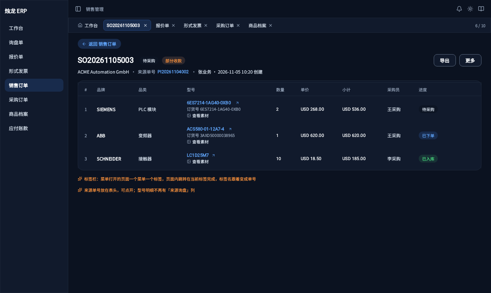
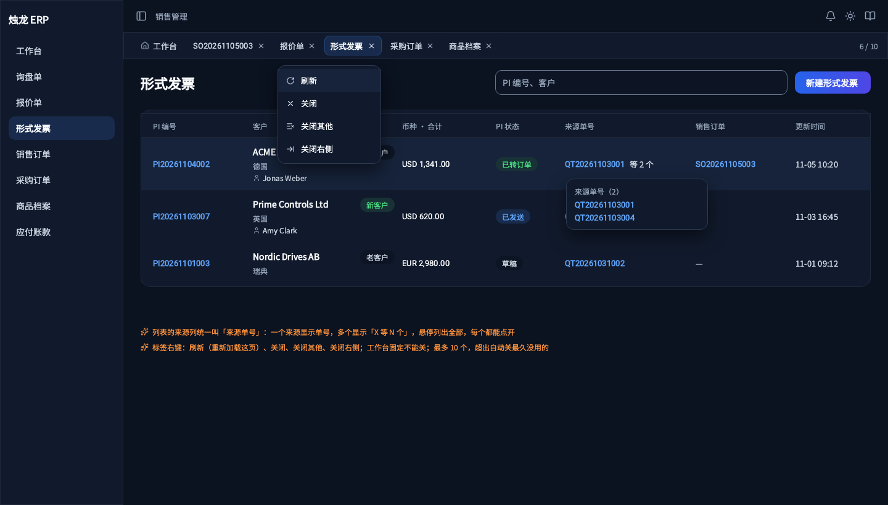
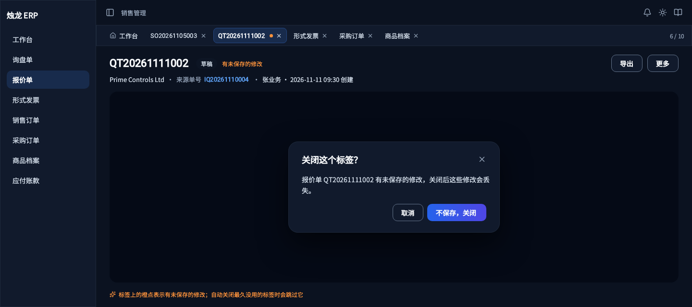
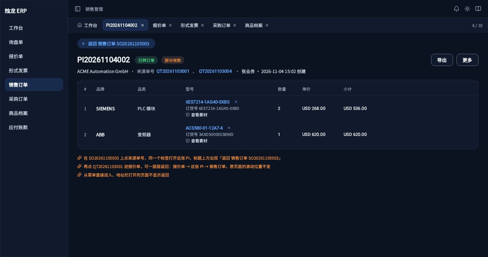
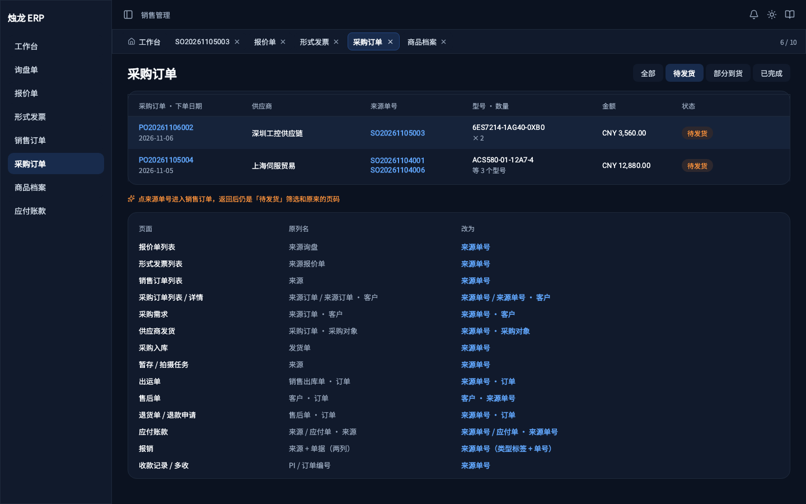

# 标签页与来源单号使用手册

> 文档版本：V1.0
> 适用版本：1.17.0 及以后
> 面向角色：所有员工
> 最近更新：2026-11-13
> 截图来源：产品原型 `docs/03-产品原型/03-业务域/11-11来源单号与标签页/`

同时看几张单据时，不用再开多个浏览器窗口：从左侧菜单打开的页面都会变成页面上方的一个**标签**，点标签就能来回切换，每个标签里的筛选、页码、填了一半的内容都会保留。从一张单据点到另一张单据后，页面顶部会出现**返回**，点一下回到原来的页面。

每张单据上都有**来源单号**，就是它的上一张单据，比如销售订单的来源单号是形式发票号，点开就能看到上一张单据。

## 目录

1. [标签页](#1-标签页)
2. [返回原来的页面](#2-返回原来的页面)
3. [来源单号](#3-来源单号)
4. [常见问题](#4-常见问题)

---

## 1. 标签页

### 什么时候用

一边看销售订单、一边对报价单、一边查形式发票，或者处理一半被叫去看别的单据时。

### 你会看到什么

图注：页面最上方一排是标签。最左边的「工作台」固定不能关；当前标签高亮；右边显示已开标签数和上限（如「4 / 10」）。

### 按步骤操作

1. 点左侧菜单，例如「销售订单」：上方多出一个「销售订单」标签。
2. 再点另一个菜单，例如「报价管理」：又多一个标签，刚才的销售订单页面保留在原来的标签里。
3. 点上方的「销售订单」标签：回到销售订单，筛选条件、页码、滚动位置都和离开时一样。
4. 在列表里点开一张订单：订单详情在**同一个标签**里打开，标签名变成订单号。
5. 不用的标签点标签上的 ×，或者用鼠标中键点标签关闭。

### 标签上的右键菜单

在标签上点右键：

| 选项 | 作用 |
|------|------|
| 刷新 | 重新加载这个标签当前的页面 |
| 关闭 | 关掉这个标签 |
| 关闭其他 | 只留下这个标签和「工作台」 |
| 关闭右侧 | 关掉它右边的所有标签 |

### 完成后会发生什么

- 同一个菜单只有一个标签。已经开着的菜单再点一次，只是切过去，页面不会重新加载。
- 最多同时开 10 个标签。开第 11 个时，系统自动关掉最久没看的那个；「工作台」和有未保存修改的标签不会被自动关。
- 按 F5 刷新浏览器后，标签都还在，当前页面重新加载；其他标签点到时再加载。
- 退出登录后标签清空。

### 容易出错的地方

- **有未保存修改的标签**：标签上有一个橙色圆点。关这个标签时会提示「有未保存的修改，关闭后这些修改会丢失」，点「不保存，关闭」才会关。切到别的标签不会丢修改。

- **刷新浏览器会丢掉没保存的内容**：标签会恢复，但页面里填了一半、还没保存的内容不会恢复，刷新前先保存。
- 想在浏览器里另开一个窗口，按住 Ctrl（Mac 上是 ⌘）再点菜单。

---

## 2. 返回原来的页面

### 什么时候用

从订单点开形式发票、从商品型号点进商品档案、从采购订单点开来源销售订单之后，想回到刚才的页面。

### 你会看到什么

图注：页面标题上方出现「← 返回 销售订单 SO20261105003」，写明会回到哪里。

### 按步骤操作

1. 在销售订单详情里点来源单号，例如 PI20261104002：形式发票在同一个标签里打开，顶部出现「← 返回 销售订单 SO…」。
2. 在形式发票里再点它的来源单号（报价单号）：顶部变成「← 返回 形式发票 PI…」。
3. 点「返回」：一层一层退回去，直到回到最开始的列表。退回的页面保留离开时的样子（滚动位置、展开的内容）。

### 「返回」和浏览器后退的区别

| | 页面上的「返回」 | 浏览器的后退按钮 |
|--|--|--|
| 回到哪里 | 只在**当前标签**里退回上一页 | 按浏览器记录退回，可能跳到别的标签 |
| 建议 | 日常都用它 | 不建议用来在单据之间返回 |

### 容易出错的地方

- 从菜单直接打开的列表页没有「返回」，因为它已经是这个标签的第一页。
- 页面有未保存修改时点「返回」，会先提示确认。

---

## 3. 来源单号

### 这是什么

每张单据的上一张单据的编号，统一叫「来源单号」，点开就能看到那张单据。

| 单据 | 来源单号是 |
|------|-----------|
| 报价单 | 询盘单号 |
| 形式发票 | 报价单号 |
| 销售订单 | 形式发票号；售后补发的是售后单号；换货重下的是原订单号；直接新建的显示「手动创建」 |
| 采购需求、采购订单 | 销售订单号 |
| 供应商发货单 | 采购订单号 |
| 采购入库单 | 供应商发货单号 |
| 闲置库存 | 采购订单号或退货单号 |
| 实拍任务 | 采购入库单号 |
| 销售出库单 | 销售订单号 |
| 出运单 | 销售出库单号 |
| 售后单 | 销售订单号 |
| 退货单、退款申请 | 售后单号 |
| 应付单 | 采购订单号或运费账单号 |
| 报销明细 | 对应的费用、运费等单据号 |
| 收款、多收 | 形式发票号或销售订单号 |

询盘单是第一张单据，没有来源单号；询盘上的「来源」指客户从哪个渠道来，和来源单号无关。

### 在哪里看

- **详情页**：标题下面的说明行写着「来源单号 PI20261104002」。一张单据有几个来源时全部列出，用顿号隔开。
- **列表页**：「来源单号」一列。有多个来源时显示「PI20261104002 等 3 个」，鼠标移上去列出全部，每个都能点。

- 报价单、形式发票、销售订单的**型号明细里不再显示来源单号**，统一看表头。

### 点开后会发生什么

- 直接打开那张单据的详情页。询盘、报价单、形式发票、订单、采购订单、供应商发货单、采购入库单、销售出库单、出运单、售后单都有详情页。
- 点顶部的「返回」回到原来的页面。

---

## 4. 常见问题

**问：标签开多了找不到怎么办？**
答：标签栏可以左右滚动；也可以在任一标签上点右键选「关闭其他」。

**问：为什么点菜单没有重新加载页面？**
答：这个菜单的标签已经开着，系统只是切过去，保留你之前的筛选。要重新加载，在标签上点右键选「刷新」。

**问：一个标签里会不会越点越多页面，很卡？**
答：每个标签只保留最近的 5 个页面，更早的页面点「返回」时会重新加载。

**问：后台标签里的数据会自动更新吗？**
答：需要定时刷新的页面（如背调进度）在后台时暂停刷新，切回来后继续。
