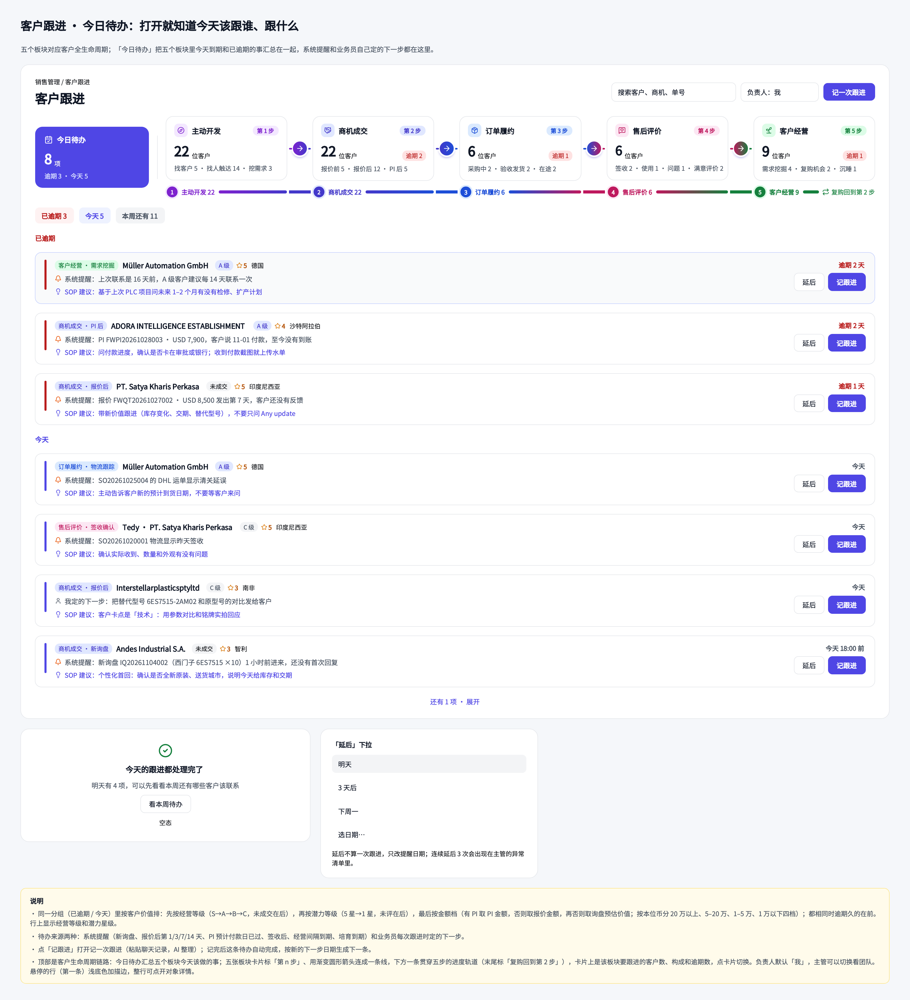
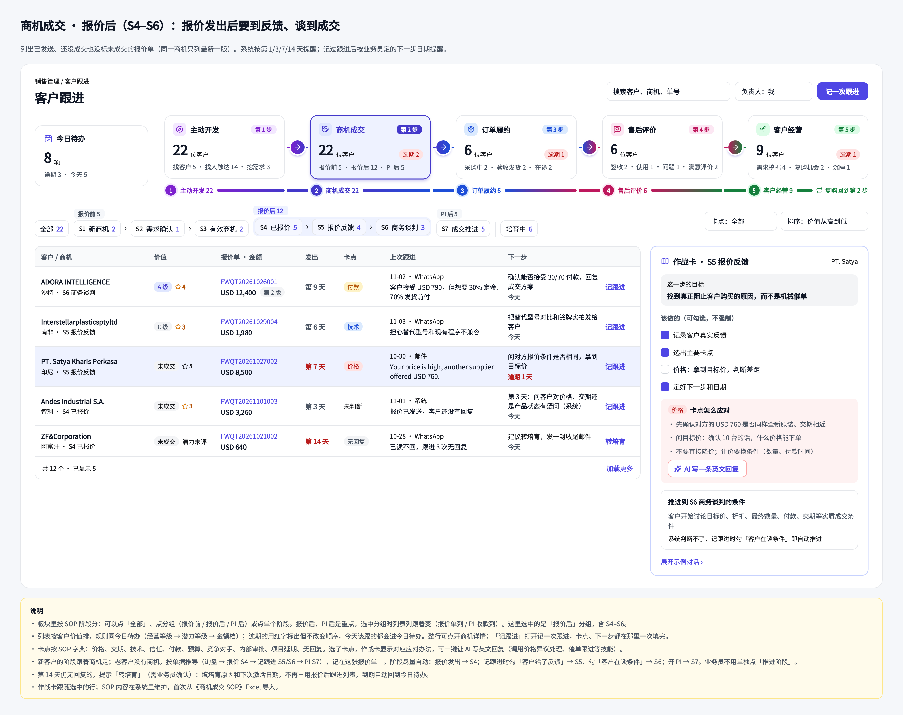
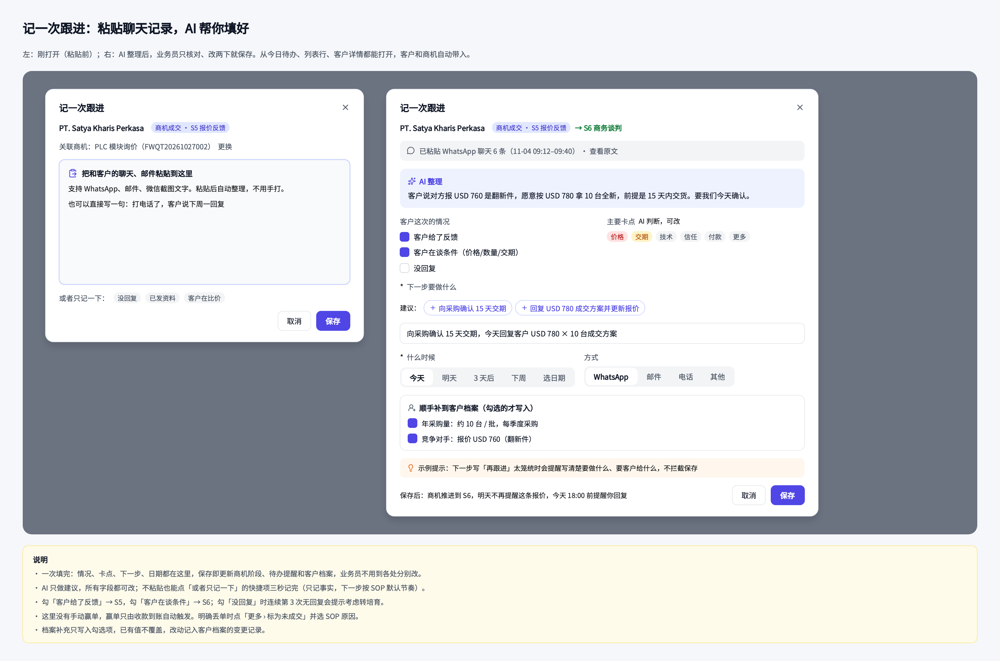
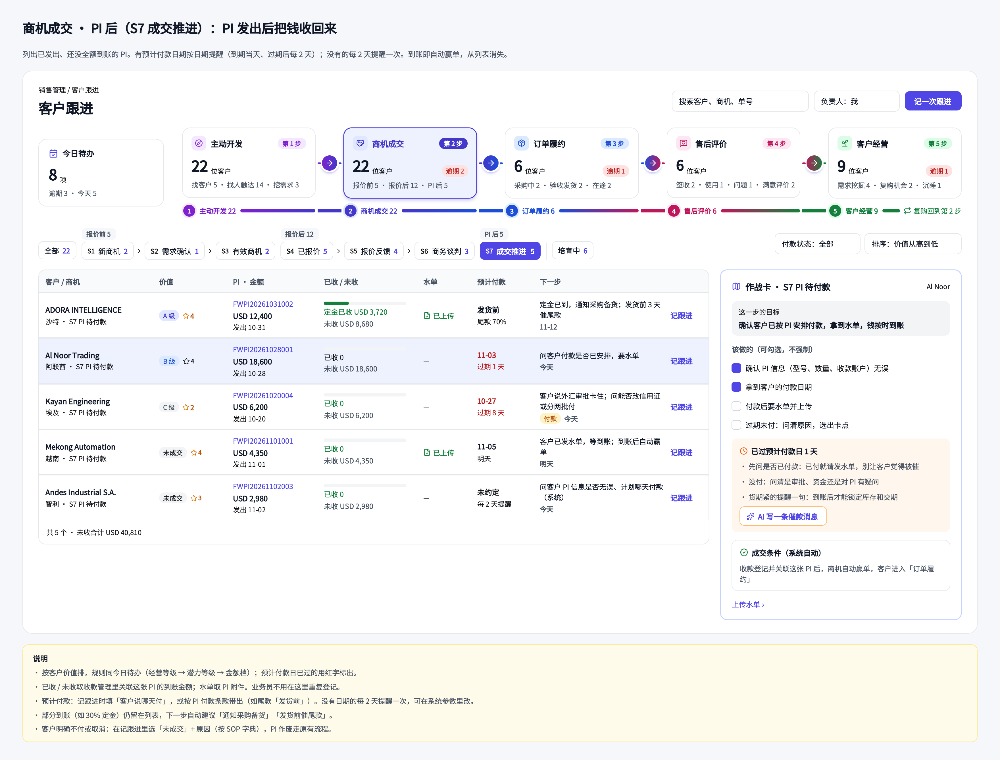
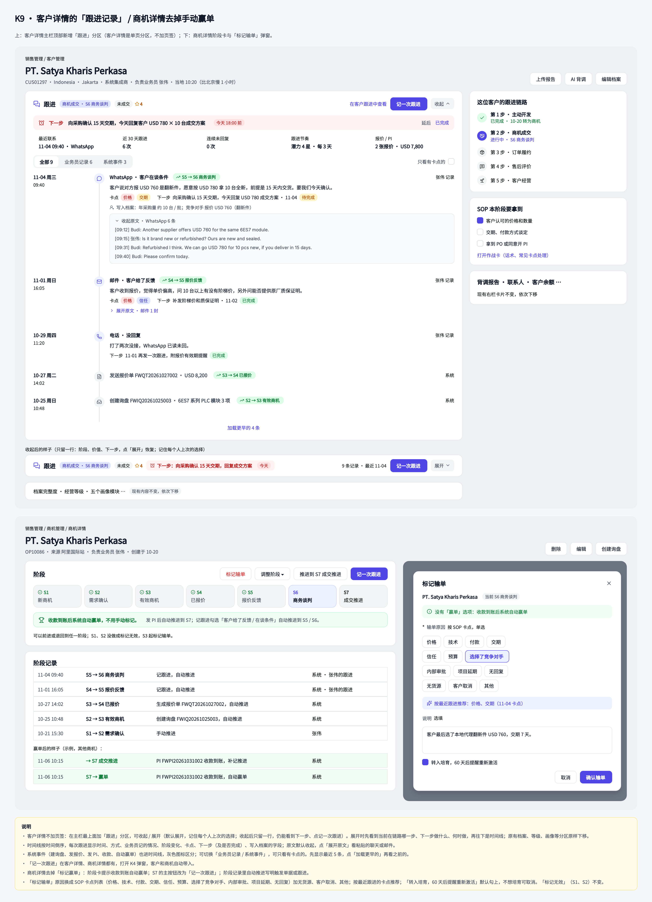
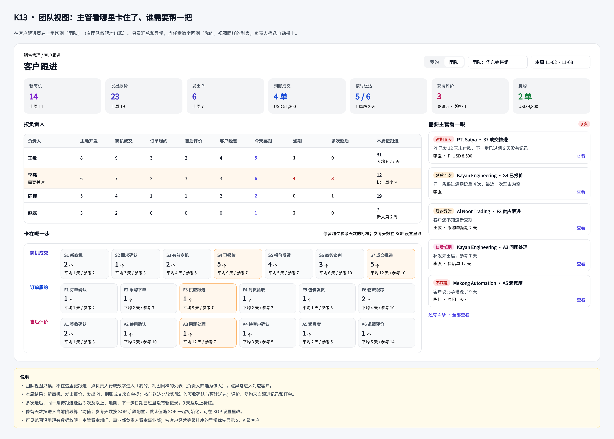
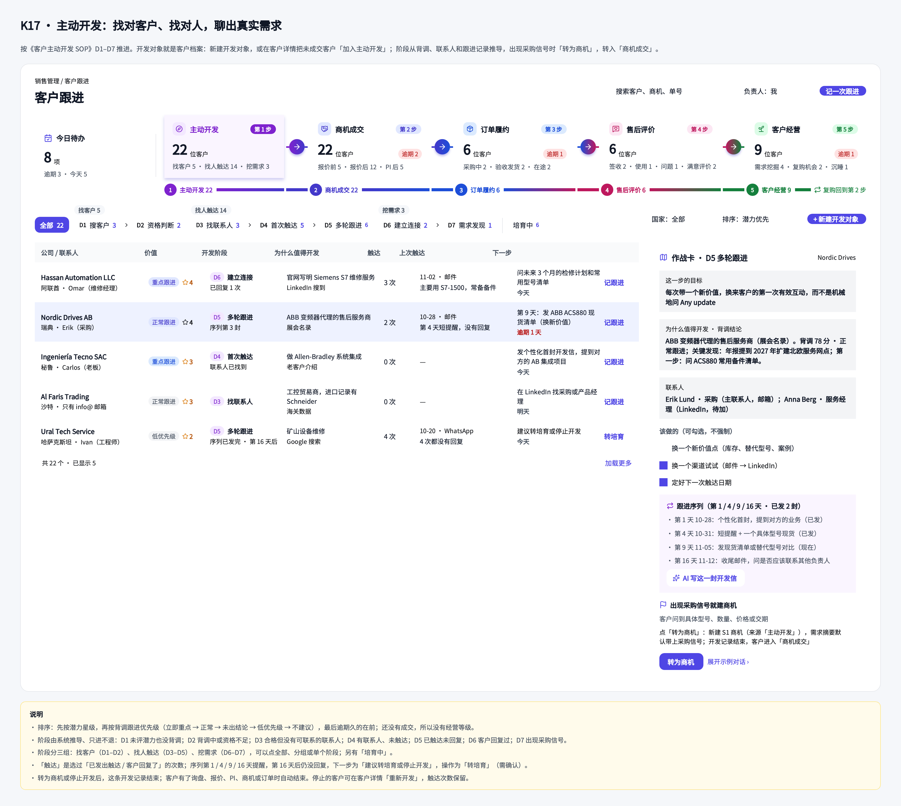
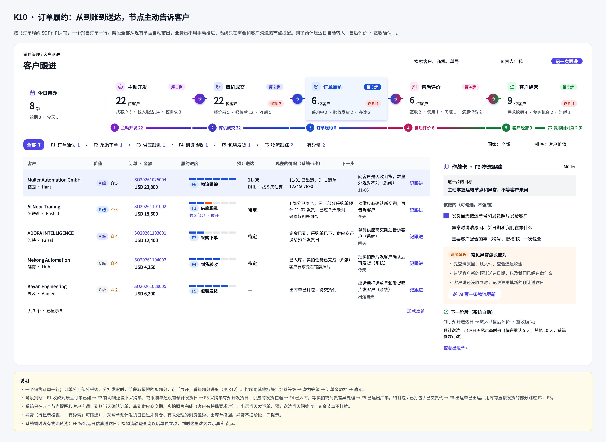
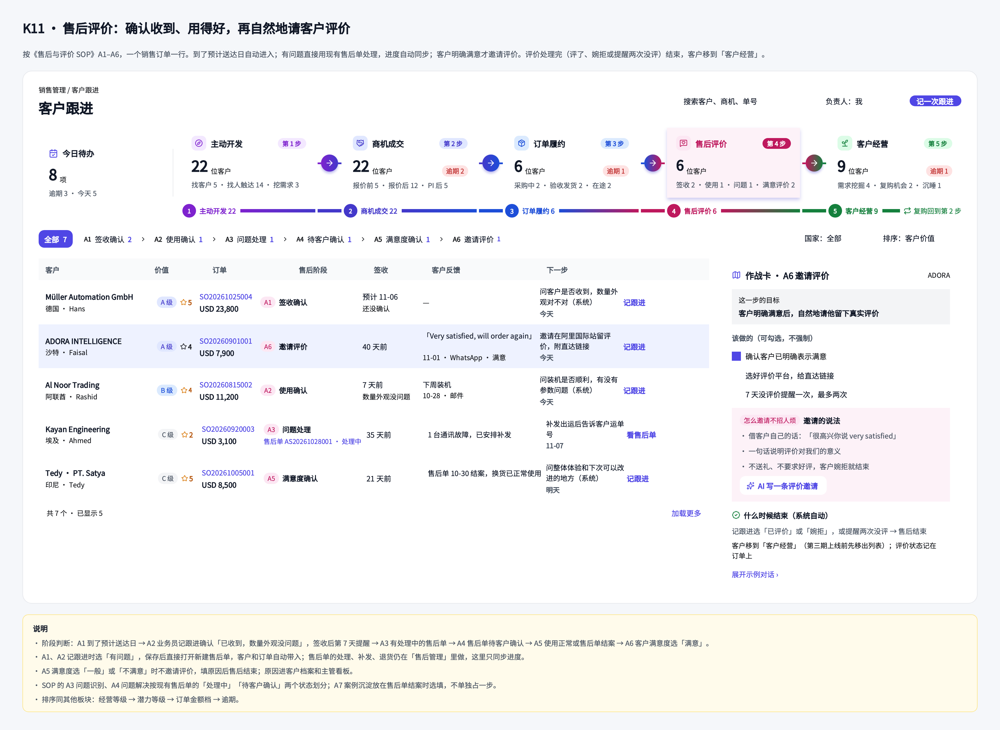
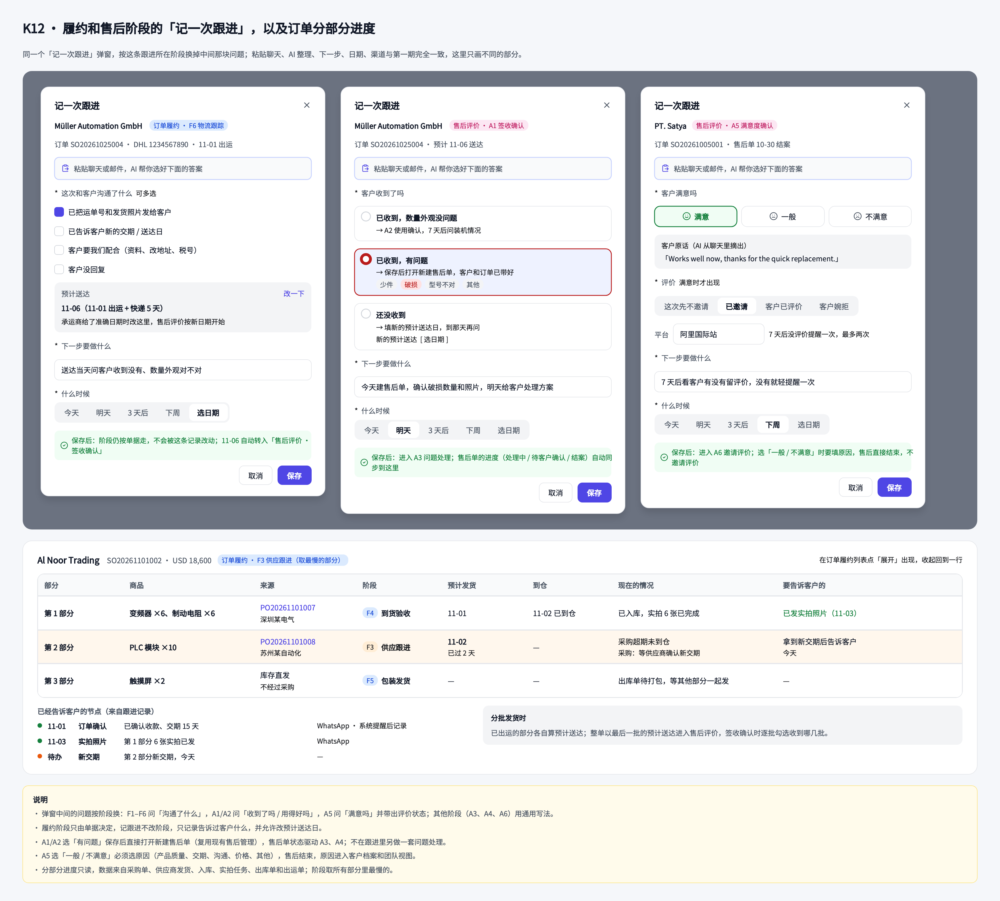

# 客户跟进使用手册

> **给谁看**：业务员、销售主管  
> **适用版本**：ERP 1.9.0 及以上  
> **文档版本**：V1.0  
> **最近更新**：2026-11-07  
> **截图来源**：客户跟进产品原型；发布前请以线上页面为准

## 先看这一页：客户跟进是做什么的？

客户跟进就是把每一次客户联系记下来，并明确下一步要做什么、什么时候做。你不需要靠记忆找客户，系统会把今天该处理的人列出来。

### 每天只做三件事

1. 打开 **销售管理 → 客户跟进**。
2. 先处理 **今日待办**，优先处理逾期项。
3. 每次联系客户后点 **记一次跟进**，写清楚下一步。

> **记住**：只写“再跟进”不够。要写成“发替代型号对比，明天问客户能否接受”。

## 目录

1. [第一次使用：先看懂页面](#1-第一次使用先看懂页面)
2. [处理今日待办](#2-处理今日待办)
3. [查看客户处在哪个阶段](#3-查看客户处在哪个阶段)
4. [记录一次跟进](#4-记录一次跟进)
5. [让 AI 帮你整理聊天记录](#5-让-ai-帮你整理聊天记录)
6. [报价后和 PI 后怎么跟](#6-报价后和-pi-后怎么跟)
7. [转培育与重新激活](#7-转培育与重新激活)
8. [客户详情里的跟进时间线](#8-客户详情里的跟进时间线)
9. [团队视图](#9-团队视图)
10. [主动开发、订单履约和售后](#10-主动开发订单履约和售后)
11. [常见问题与速查表](#11-常见问题与速查表)

## 1. 第一次使用：先看懂页面

### 1.1 页面入口

左侧菜单进入：**销售管理 → 客户跟进**。

页面默认打开 **今日待办**。上方是客户生命周期的五个板块，下方是当前需要处理的客户列表。

*图 1：先看今日待办，再按客户所处板块进入详细列表。*

### 1.2 五个板块怎么理解

| 板块 | 白话理解 | 你主要要做什么 |
| --- | --- | --- |
| 主动开发 | 还没有正式商机的潜在客户 | 找客户、找联系人、确认需求 |
| 商机成交 | 正在报价、谈条件、推进成交的客户 | 回复客户、处理报价和 PI |
| 订单履约 | 客户已经下单，正在交付 | 跟进生产、发货、到货 |
| 售后评价 | 客户已收货，需要确认使用情况 | 处理问题、收集评价 |
| 客户经营 | 已成交客户的长期维护 | 找复购、交叉销售、维护战略客户 |

## 2. 处理今日待办

### 2.1 先处理逾期项

打开页面后，先看“已逾期”，再看“今天”。每条待办都会告诉你：客户是谁、处在哪个阶段、为什么提醒、到期多久。

**操作步骤**

1. 找到一条逾期或今天到期的记录。
2. 先打开客户最近的报价、PI 或跟进记录。
3. 联系客户后，点击 **记跟进**。
4. 如果今天还不能处理，点击 **延后**，选择明天、3 天后、下周一或指定日期。

*图 2：红色日期表示已经逾期；“记跟进”会打开记录窗口，“延后”只改变提醒日期。*

### 2.2 记跟进和延后的区别

- **记跟进**：表示你已经联系或处理了客户，会新增一条跟进记录。
- **延后**：表示暂时没处理，只改提醒日期，不新增跟进记录。

## 3. 查看客户处在哪个阶段

### 3.1 商机成交阶段

报价前通常是 S1–S3，报价后是 S4–S6，PI 发送后是 S7。

| 阶段 | 说明 |
| --- | --- |
| S1 新商机 | 刚发现可能成交的机会 |
| S2 需求确认 | 正在确认型号、数量、交期等需求 |
| S3 有效商机 | 需求比较明确，还没有报价 |
| S4 已报价 | 报价已经发给客户 |
| S5 报价反馈 | 客户已经回复报价或提出问题 |
| S6 商务谈判 | 正在谈价格、付款、交期等条件 |
| S7 成交推进 | PI 已发送，等待收款或后续成交 |

*图 3：点击阶段导航，可以只看某一阶段的客户。*

### 3.2 系统为什么会自动出现跟进对象？

系统会根据询盘、报价单和 PI 自动生成跟进对象。例如：

- 报价单发送后，自动进入“报价后”；
- 报价转成 PI 后，报价对象由 PI 接替；
- PI 全额到账或关闭后，从 PI 后列表移出。

你不用重复创建这些对象，只需要处理列表中的下一步。

## 4. 记录一次跟进

### 4.1 什么时候要记录？

客户回复邮件、WhatsApp、电话或其他渠道后，都建议记录一次。没有回复时，也可以记录“没回复”，这样团队知道你已经处理过。

### 4.2 按步骤填写

1. 点击 **记一次跟进**。
2. 确认客户和关联的报价单、PI 或订单。
3. 选择客户情况：**客户给了反馈 / 客户在谈条件 / 没回复**。
4. 有明确问题时，选择主要卡点，例如价格、交期、产品、付款。
5. 填写下一步要做什么，必须写具体动作，最多 200 字。
6. 选择什么时候做下一步。
7. 选择沟通方式：WhatsApp、邮件、电话或其他。
8. 有聊天原文时粘贴到“原始记录”，再保存。

*图 4：保存前确认“下一步”具体、可执行。*

### 4.3 填写示例

| 字段 | 推荐填写 |
| --- | --- |
| 客户情况 | 客户给了反馈、客户在谈条件 |
| 主要卡点 | 价格 |
| 下一步 | 发 USD 780 / 10 台全新方案，明天确认客户是否接受 |
| 什么时候 | 明天 |
| 方式 | WhatsApp |

### 4.4 保存后会发生什么？

保存后，系统会在一次操作里完成：

- 新增跟进记录；
- 更新客户的卡点、上次跟进和下一步；
- 按选择推进阶段；
- 关闭当前待办；
- 在下一步日期重新提醒你。

## 5. 让 AI 帮你整理聊天记录

### 5.1 使用方法

1. 把客户聊天或邮件粘贴到“原始记录”。
2. 等待 AI 整理摘要、客户情况、卡点和下一步建议。
3. 逐项检查 AI 结果，必要时修改。
4. 点建议旁边的按钮，把合适的建议填入下一步。
5. 确认后保存。

AI 只提供建议，不会自动发送消息，也不会替你保存未经确认的内容。

### 5.2 一个好例子

客户说竞争对手报价 USD 760，但怀疑是翻新件；客户愿意 USD 780 采购 10 台全新产品，并要求 15 天交货。

你可以让 AI 帮你整理出：

- 客户给了反馈；
- 客户在谈条件；
- 主要卡点是价格和交期；
- 下一步是确认 15 天交期，并回复 USD 780 的成交方案。

### 5.3 AI 没有结果怎么办？

AI 失败或超过 60 秒时，系统会提示“AI 暂时没有整理出来，可以直接填写”。这不会影响你手工填写和保存。

## 6. 报价后和 PI 后怎么跟

### 6.1 报价后

报价发送后，系统会在第 1、3、7、14 天提醒。你每次沟通后都记录客户反馈，阶段会逐步推进。

建议动作：

- 第 1 天：确认客户是否收到报价；
- 第 3 天：问客户对价格、交期还是产品有疑问；
- 第 7 天：确认客户内部评估进度；
- 第 14 天：没有回复时，考虑转入培育。

### 6.2 PI 后

PI 发送后，重点看付款进度、预计付款日期和水单。

*图 5：PI 后列表显示已收、未收和预计付款信息。*

如果客户说“周五付款”，在跟进记录里填写客户说哪天付，后续提醒会更准确。

## 7. 转培育与重新激活

当报价发出 14 天仍没有反馈，或连续 3 次跟进都没有回复，系统可能显示 **建议转培育**。

### 操作步骤

1. 点击 **转培育**。
2. 选择原因，例如价格、时机、没有回复。
3. 填写说明。
4. 选择下次激活日期，默认是 60 天后。
5. 确认保存。

转培育后，客户暂时不占用原阶段列表；到了激活日期，系统会把客户放回原阶段，并提醒你重新联系。

## 8. 客户详情里的跟进时间线

打开客户详情，最上方是“跟进”分区。这里可以看到客户当前阶段、下一步、最近联系和历史记录。

*图 6：客户详情把业务员记录和系统事件放在同一条时间线上。*

时间线中的灰色记录是系统事件，例如创建询盘、发送报价、PI 收款到账；业务员记录会显示沟通方式、客户情况、卡点和下一步。

## 9. 团队视图

有权限的主管可以切换到 **团队**，查看哪些客户逾期、谁的客户卡住、哪些客户连续没有回复。

*图 7：团队视图用于发现需要协助的客户，不替业务员自动完成跟进。*

主管可以点击指标，回到列表查看具体客户；普通业务员默认只看到自己负责的对象。

## 10. 主动开发、订单履约和售后

### 10.1 主动开发

主动开发分为找客户、找人触达、挖需求。每次触达都记录结果；客户明确有需求时，可以转成商机。

### 10.2 订单履约

客户下单后，跟进重点变成交期、发货、到货和异常处理。

### 10.3 售后评价

客户收货后，确认是否正常使用、有无问题、是否愿意评价或复购。

履约和售后也使用同一个“记一次跟进”窗口，区别是问题类型、处理动作和下一步会随阶段变化。

## 11. 常见问题与速查表

### 常见问题

**Q：我只是把待办延后了，为什么没有新的跟进记录？**  
A：延后只改变提醒日期。如果你已经联系客户，要使用“记一次跟进”。

**Q：为什么客户自动出现在报价后？**  
A：报价单发送后系统会自动生成报价后跟进对象，这是正常流程。

**Q：下一步可以只写“再跟进”吗？**  
A：不建议。请写清楚动作和对象，例如“发替代型号对比，明天问客户能否接受”。

**Q：AI 整理失败还能保存吗？**  
A：可以。AI 只是辅助，直接手工填写即可。

**Q：为什么我看不到团队视图？**  
A：团队视图需要“查看团队”权限，请联系主管或系统管理员。

### 一页速查表

| 我想做什么 | 入口 | 关键动作 |
| --- | --- | --- |
| 看今天该跟谁 | 销售管理 → 客户跟进 | 先处理逾期，再处理今天 |
| 记录客户回复 | 今日待办或列表 | 记一次跟进 |
| 暂时无法处理 | 今日待办 | 延后 |
| 查看报价进度 | 商机成交 | 选择报价前 / 报价后 / PI 后 |
| 客户长期没回复 | 报价后列表 | 转培育并设激活日期 |
| 查看客户全部历史 | 客户详情 | 展开跟进时间线 |
| 查看团队卡点 | 客户跟进 → 团队 | 点击指标查看客户 |
| 让 AI 整理聊天 | 记一次跟进 | 粘贴原始记录并检查建议 |

> **最后提醒**：每次联系客户后都留下一条记录，并写清楚下一步。客户跟进的核心不是“记过了”，而是“下一步有人负责、日期明确”。
