# 供应链跟进与覆盖矩阵使用手册

> **给谁看**：采购员、供应链负责人、采购主管  
> **适用版本**：供应链管理第一期上线后的版本  
> **文档版本**：V1.0  
> **最近更新**：2026-11-14  
> **截图来源**：供应链第一期产品原型（与本地页面走查核对过）；发布前请以线上页面为准

## 先看这一页：供应链跟进是做什么的？

客户问过、买过、问不到货的型号，系统每天自动收集起来，帮你回答两个问题：

1. **哪些型号值得备好货源？**（需求情报）
2. **这些型号现在能不能马上报价？**（供应覆盖）

你不需要自己翻询盘和询价记录。每天打开页面，先处理系统列出的待办，把「无渠道」「需确认」的型号一个个补成「可直接报价」。

### 每天只做三件事

1. 打开 **供应链管理 → 供应链跟进**，先处理 **今日待办**，优先处理逾期项。
2. 每找一次供应商、问一次价，点 **记一次处理**，写清楚做了什么、下一步做什么。
3. 有空时进 **供应覆盖**，从「近 30 天无货」最多的品牌开始补渠道。

> **记住**：只写“再问问”不够。要写成“问上海倍讯有没有现货，周四前回复”。

## 目录

1. [第一次使用：先看懂页面](#1-第一次使用先看懂页面)
2. [处理今日待办](#2-处理今日待办)
3. [记一次处理](#3-记一次处理)
4. [需求情报：归类、录入信号、调整优先级](#4-需求情报归类录入信号调整优先级)
5. [供应覆盖：把缺口补成可报价](#5-供应覆盖把缺口补成可报价)
6. [型号详情](#6-型号详情)
7. [专项：集中解决一批缺口](#7-专项集中解决一批缺口)
8. [覆盖矩阵](#8-覆盖矩阵)
9. [团队视图（主管）](#9-团队视图主管)
10. [常见问题与速查表](#10-常见问题与速查表)

## 1. 第一次使用：先看懂页面

### 1.1 页面入口

左侧菜单进入：**供应链管理 → 供应链跟进**。看不到这个菜单，请找管理员在角色里勾选「供应链跟进」。

页面最上面是一条链路：**今日待办** 和五个板块。本期能用的是第 1 步 **需求情报** 和第 2 步 **供应覆盖**；后面三步显示「即将上线」。

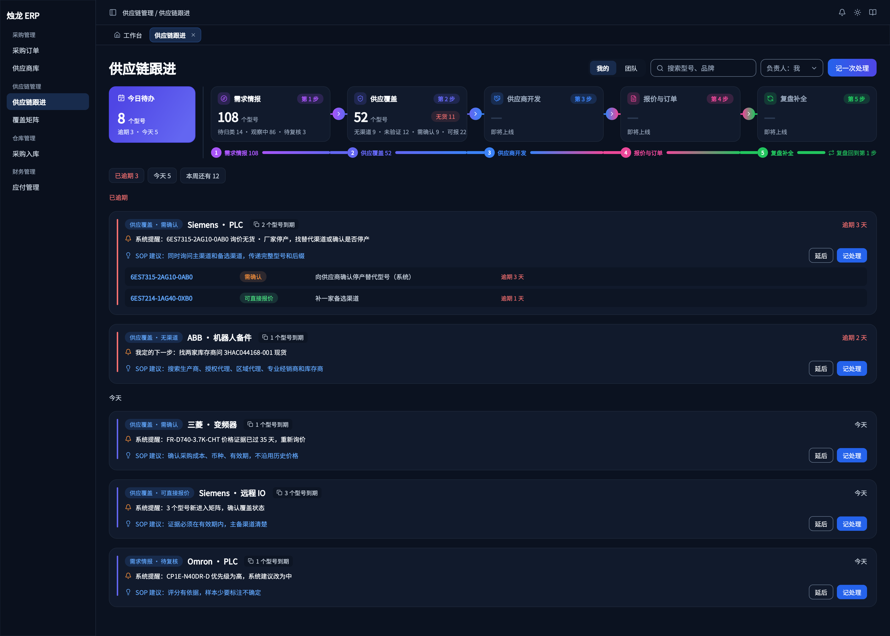

*图 1：左边是今日待办，右边是五个板块；点板块卡片切换下面的列表。*

### 1.2 几个词先弄懂

| 词 | 白话解释 |
| --- | --- |
| 需求信号 | 一次“有人要这个型号”的记录：询盘、销售订单、询价无货、报价没成交、搜索关键词、同行调研 |
| 需求对象 | 同一个型号（或同一品牌 + 品类）的所有信号合在一起，就是一个需求对象，页面上就是一行型号 |
| 优先级 | 高、中、低。系统按近 90 天的信号自动建议，例如询盘 3 次以上为「高」 |
| 覆盖矩阵 | 值得备货源的型号清单。高、中优先级的型号自动进入 |
| 覆盖状态 | 这个型号现在能不能报价，分四档，见下表 |
| 证据 | 有单价的询价记录，或已下单的采购订单。默认 30 天内有效 |

**四档覆盖状态**（从差到好）：

| 状态 | 什么意思 | 你该做什么 |
| --- | --- | --- |
| 无渠道 | 没有任何供应商能做 | 找供应商 |
| 有线索未验证 | 有供应商主营这个品牌，但没问过这个型号 | 去问价 |
| 需确认 | 以前问到过价，但已经过期 | 向供应商重新确认 |
| 可直接报价 | 30 天内有价格、货期 | 保持，再找一家备选 |

### 1.3 负责人筛选

右上角「负责人」默认是 **我**，只看你负责的型号。刚开始用、名下还没有型号时，系统会自动切到 **全部**。你第一次给某个型号记处理，它就会归到你名下。

## 2. 处理今日待办

### 2.1 待办从哪里来

今日待办列出 **你负责的、下一步日期已到或已过** 的型号，按「品牌 · 品类」合成一张卡片。待办有两种来源：

- **我定的下一步**：你记处理时填的下一步。
- **系统提醒**：例如“询价无货 · 原厂停产，找替代渠道或确认是否停产”“新进入矩阵，确认覆盖状态”“证据过期 · 重新询价”。

*图 2：红色为已逾期；卡片上有 SOP 建议，告诉你这一步该怎么做。*

### 2.2 按步骤处理

1. 先点 **已逾期**，从最上面一张开始。
2. 读卡片上的待办来源和 SOP 建议。
3. 去问供应商（可以在「询价分配」发起询价任务）。
4. 回来点 **记处理**，写结果和下一步（见第 3 节）。
5. 今天确实处理不了，点 **延后**，选一个新日期。

> **注意**：同一个型号延后 3 次以上，会出现在主管的「需要主管看一眼」里。

### 2.3 全部处理完

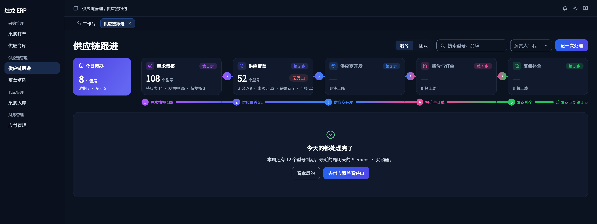

*图 3：处理完会提示本周还有多少型号到期，可以点「去供应覆盖看缺口」继续补渠道。*

## 3. 记一次处理

### 3.1 什么时候用

每次你为某些型号做了事：问了供应商、确认了停产、找到替代型号、拿到报价……都记一次。

### 3.2 按步骤操作

1. 在今日待办卡片、列表的组行或型号行、型号详情页点 **记处理**；也可以点右上角 **记一次处理** 再搜索型号。
2. 勾选这次处理涉及的型号（默认全选）。
3. 在 **做了什么** 里写清楚问了谁、得到什么答复。
4. **结果**（选填）：如果状态变了，选新的覆盖状态。
5. 填 **下一步行动** 和 **行动日期**。可以点「推荐」用系统建议的日期。
6. 点 **保存**。

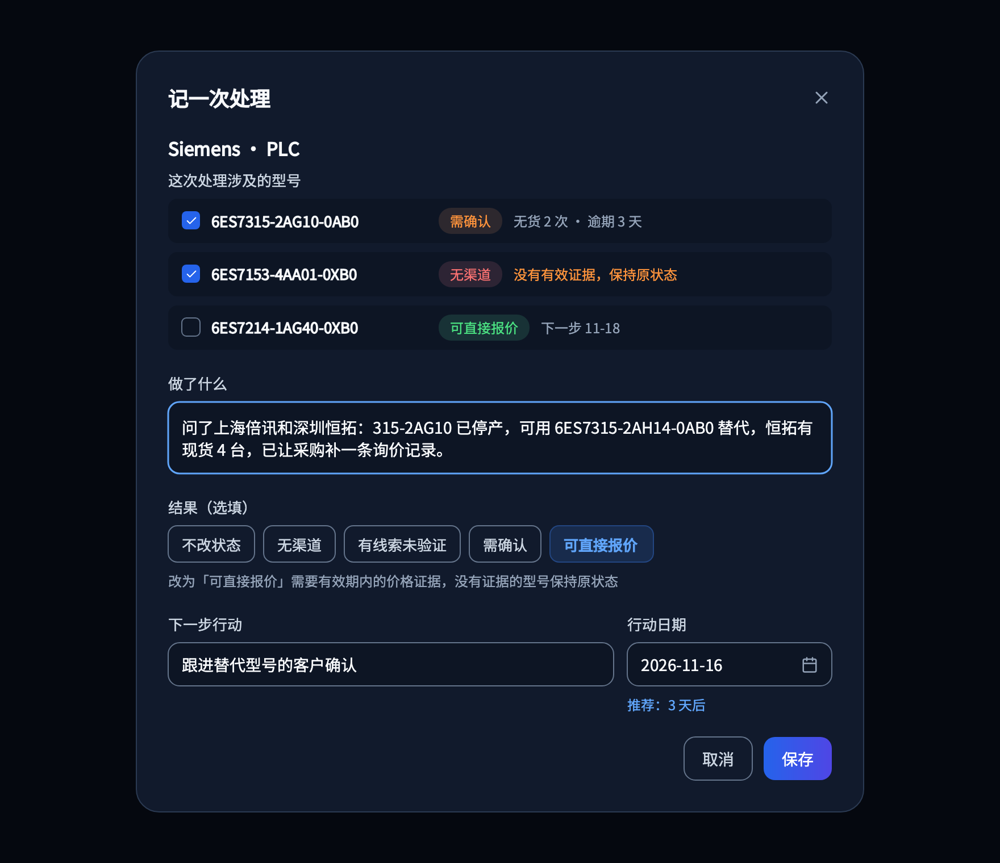

*图 4：一次可以给同一组的多个型号记处理。*

### 3.3 填写示例

| 字段 | 示例 |
| --- | --- |
| 做了什么 | 问了上海倍讯和深圳恒拓：315-2AG10 已停产，可用 315-2AH14 替代，恒拓有现货 4 台 |
| 结果 | 需确认 |
| 下一步行动 | 向客户确认能否接受替代型号 |
| 行动日期 | 推荐 2 天后 |

**系统推荐的下一步日期**：无渠道、有线索未验证 3 天后；需确认 2 天后；可直接报价为证据到期前 5 天。

### 3.4 保存后会发生什么

- 型号的时间线多一条处理记录，今日待办和各处数字刷新。
- 型号没有负责人时，自动设为你。
- 选了「可直接报价」但型号没有 30 天内的价格证据时，这个型号保持原状态，页面会提示有几个没改。

### 3.5 容易出错的地方

- **下一步必须填**。只有所选型号都已是「可直接报价」且有备选渠道时才可以不填。
- 下一步日期不能早于今天。
- 连点两次保存不会记两条。

### 3.6 系统自动记的处理

询价任务回价后，系统会自动给型号记一条，处理人显示「系统」：

- 有价：覆盖状态改为「可直接报价」，系统提醒清掉，你定的下一步保留。
- 无货：同时产生一条「询价无货」信号和提醒。
- 回价被撤回：记一条撤回记录，状态退回系统建议。

## 4. 需求情报：归类、录入信号、调整优先级

点链路上的 **需求情报**。下面的阶段按钮：

| 阶段 | 是什么 |
| --- | --- |
| 待归类 | 系统认不出品牌或型号的信号，需要人工归到需求对象 |
| 观察中 | 还没进入覆盖矩阵的型号（多为低优先级） |
| 待复核 | 系统建议的优先级和人工改过的不一样 |
| 暂不覆盖 | 人工设为暂不跟的型号 |

### 4.1 归类信号

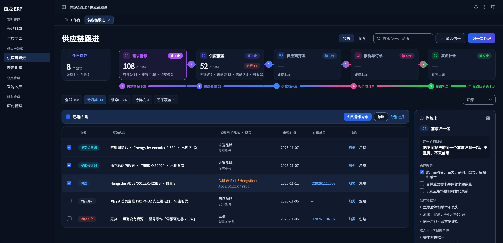

*图 5：「识别到的品牌 · 型号」橙色表示系统没认出品牌。*

1. 点 **待归类**。
2. 单条点 **归类**；多条先勾选，再点上方的 **归到需求对象**。
3. 选 **品牌** 和 **二级品类**；型号可不填。
4. 看下面的 **将归到**，确认无误后点 **确认归类**。

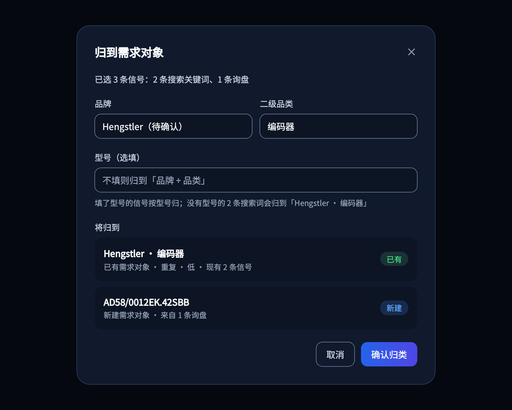

*图 6：不填型号时，有型号的信号按各自型号归（同一型号归到一起），没有型号的归到「品牌 · 品类」。*

**为什么**：同一个型号写法不同（大小写、空格、横杠）时，系统会自动认成同一个。

### 4.2 忽略信号

明显无效的信号（重复录入、型号乱写）点 **忽略**，填原因。忽略后不再计入次数，记录会保留。

### 4.3 录入搜索关键词和同行调研

询盘、订单、询价无货、报价未成交这四种信号由系统每天凌晨自动收集。**搜索关键词** 和 **同行调研** 需要人工录入：

1. 切到 **需求情报**，点右上角 **录入信号**。
2. 选类型、平台，填关键词或调研内容。
3. 搜索关键词还要填出现次数和统计期。

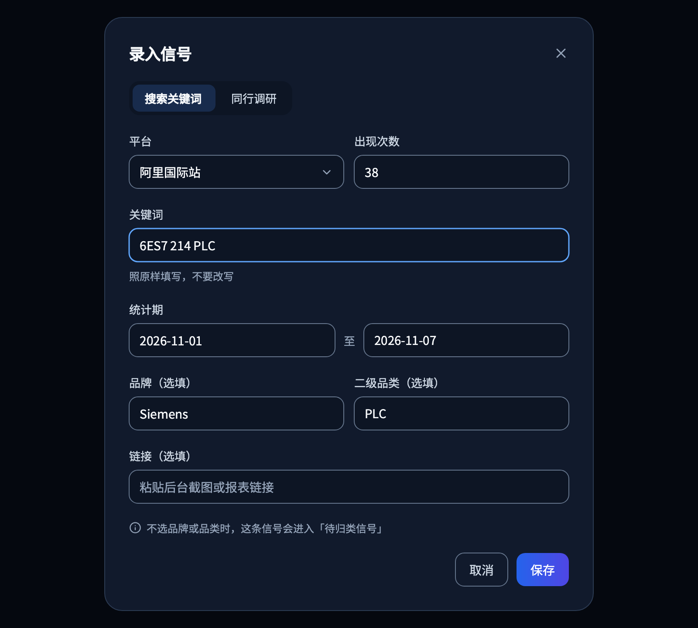

*图 7：示例：阿里国际站，关键词「6ES7 214 PLC」，出现 38 次，统计期 11-01 至 11-07。*

### 4.4 调整优先级、暂不覆盖、加入矩阵

在型号详情页右上角操作（见第 6 节）：

- **改优先级**：必须写理由。人工改过的优先级系统不会再覆盖。
- **暂不覆盖**：必须写原因。设了以后不再出现在覆盖矩阵、今日待办和专项里，随时可以 **恢复**。
- **加入矩阵**：低优先级的型号也想备货源时手动加入。

## 5. 供应覆盖：把缺口补成可报价

点链路上的 **供应覆盖**。

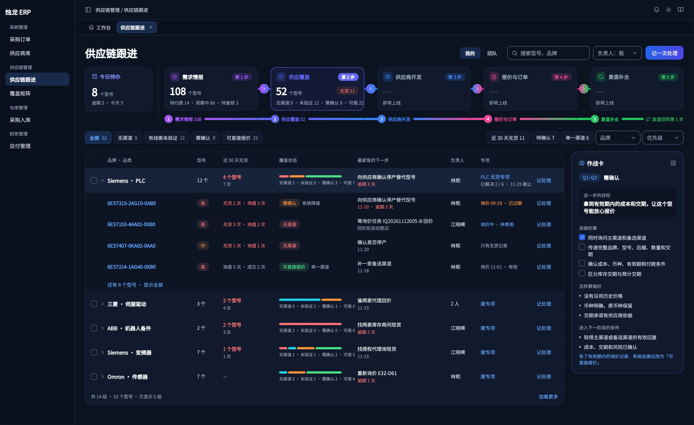

*图 8：按「品牌 · 品类」分组，组行的彩色条是四档状态的分布；点组行展开型号；右侧作战卡说明这一步怎么做。*

### 5.1 常用筛选

- **近 30 天无货**：最近问不到货的型号，最该先补。
- **待确认**：刚进入矩阵、系统给了建议状态还没人确认的。
- **单一渠道**：能报价但只有一家供应商的，建议再找一家备选。
- 还可以按品牌、品类、优先级筛选，或在右上角搜索型号。

### 5.2 批量操作

勾选多个型号后，上方出现 **记处理**、**延后**、**取消选择**。

### 5.3 确认或修改覆盖状态

在型号详情页「覆盖情况」点 **改状态**（需要「维护覆盖矩阵」权限）。

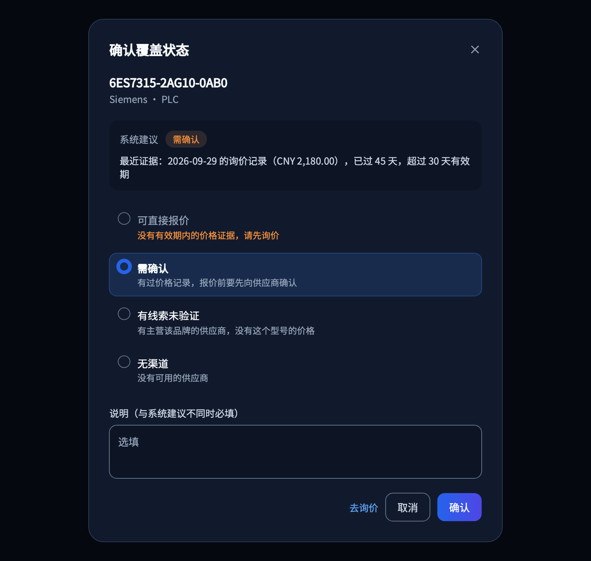

*图 9：系统建议和依据写在上面；选的状态和建议不同时必须写说明。*

- 没有 30 天内的证据时，不能选「可直接报价」，可以点 **去询价**。
- 已是「可直接报价」的型号，证据过期后系统会自动改为「需确认」。

## 6. 型号详情

点任意型号进入。

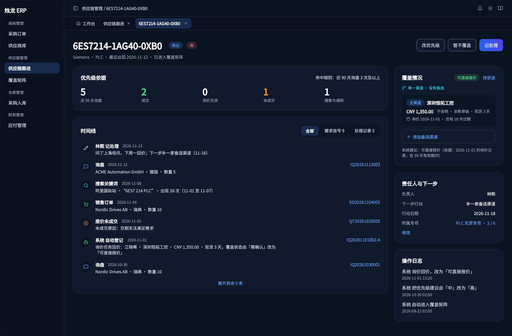

*图 10：左边是优先级依据和时间线，右边是覆盖情况、负责人与下一步、操作日志。*

| 区域 | 看什么 |
| --- | --- |
| 优先级依据 | 近 90 天询盘、成交、询价无货、未成交、搜索与调研次数，以及命中的规则 |
| 时间线 | 所有信号和处理记录，可按「需求信号」「处理记录」筛选；点单号打开原单据 |
| 覆盖情况 | 当前状态、主渠道和备选渠道的价格与询价日期、系统建议和依据 |
| 负责人与下一步 | 点 **修改** 换负责人或改下一步 |

**添加备选渠道**：在「覆盖情况」点 **添加备选渠道**（还没有渠道时为 **设置渠道**），搜索并选择供应商。需要同时有「维护覆盖矩阵」和「查看货源信息」权限；没有「查看货源信息」权限的人看不到供应商和价格。

## 7. 专项：集中解决一批缺口

### 7.1 什么时候用

某个品牌或品类无货特别集中（例如 Siemens PLC 一个月无货 4 个型号），需要指定一个人在截止日期前集中解决。

### 7.2 建专项

1. 在供应覆盖的组行、覆盖矩阵「按无货」的格子下方，或团队视图的无货排行，点 **建专项**。
2. 确认品牌、品类（不选品类表示该品牌全部品类）。
3. 填 **名称**、**目标**、**负责人**、**截止日期**。
4. 检查带入的型号（系统自动带入无渠道、有线索未验证、近 30 天无货的型号），可以取消勾选。
5. 点 **建立专项**。

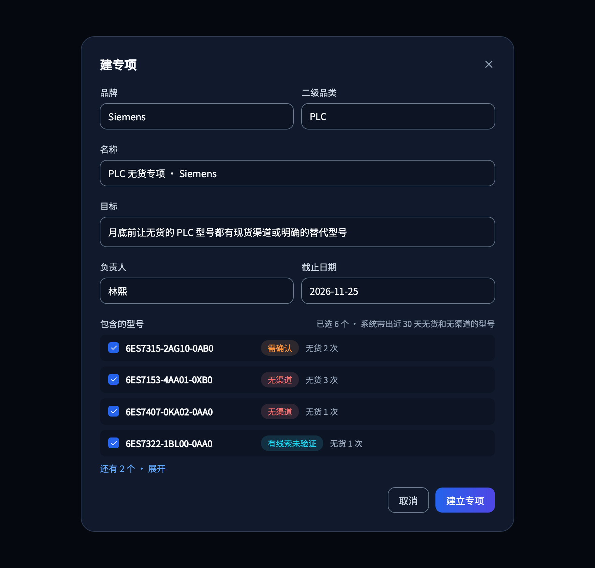

*图 11：同一个品牌 + 品类同时只能有一个进行中的专项，已有时会提示打开它。*

### 7.3 跟进与结束

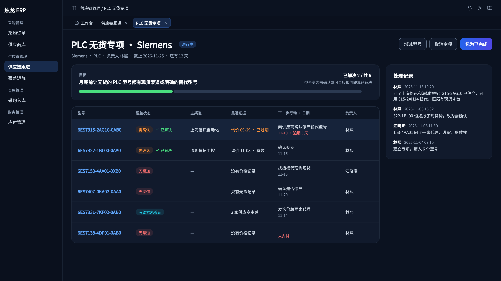

*图 12：型号变为「需确认」或「可直接报价」就算已解决。*

- **增减型号**：只能加入范围内已进入覆盖矩阵的型号。
- **标为已完成**：填结果说明。
- **取消专项**：填原因。
- 过了截止日期还没结束的专项标为超期，会出现在负责人的今日待办和主管的团队视图。

## 8. 覆盖矩阵

左侧菜单进入：**供应链管理 → 覆盖矩阵**。行是品牌，列是二级品类。

### 8.1 按覆盖状态

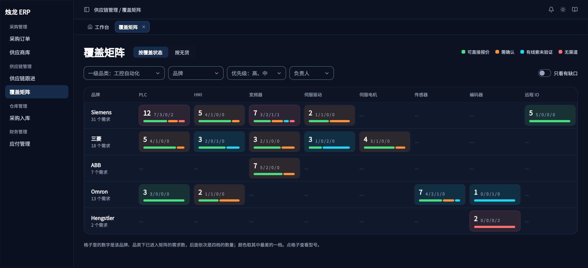

*图 13：格子里的大数字是型号数，后面依次是可直接报价 / 需确认 / 有线索未验证 / 无渠道的数量；颜色取最差的一档。*

- 打开右上角 **只看有缺口**，只显示还有「无渠道」「有线索未验证」的格子。
- 可按一级品类、品牌、优先级、负责人筛选。

### 8.2 按无货

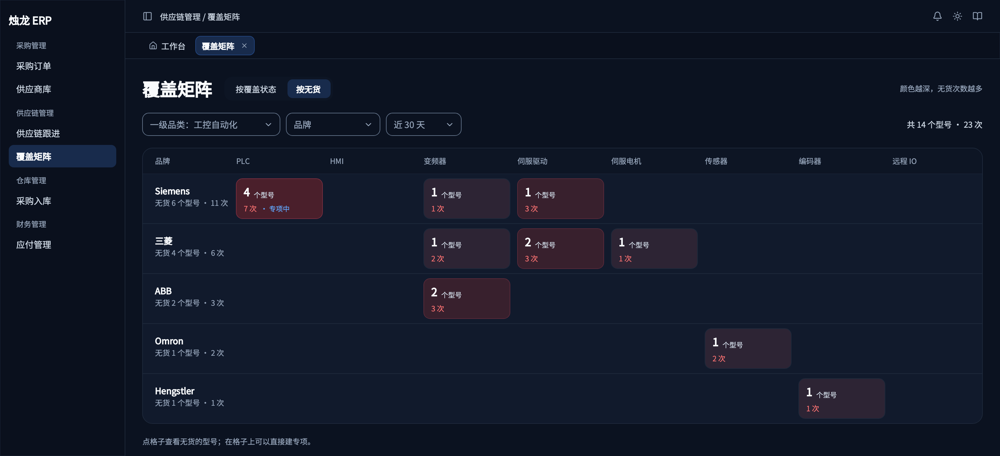

*图 14：颜色越深，近 30 天（可切换近 90 天）无货次数越多；格子下方可直接建专项。*

### 8.3 型号清单

点任意格子，进入该品牌品类的型号清单。

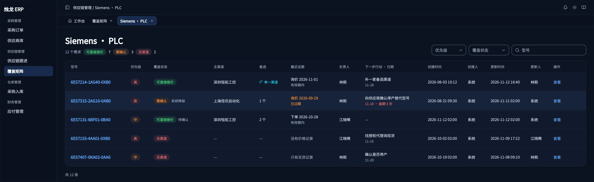

*图 15：可按优先级、覆盖状态筛选，也可以搜索型号；默认按更新时间倒序。*

## 9. 团队视图（主管）

有「查看供应链团队视图」权限的用户，在供应链跟进页右上角切换到 **团队**。

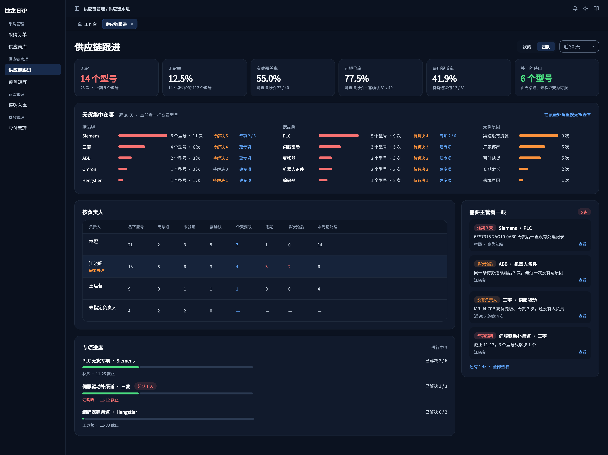

*图 16：上面是结果指标，下面是无货集中在哪、按负责人、专项进度和需要主管看一眼。*

| 指标 | 怎么算 |
| --- | --- |
| 无货 | 统计期内无货的型号数和次数，对比上一期 |
| 有效覆盖率 | 可直接报价 ÷ 高、中优先级且已进入矩阵的型号 |
| 可报价率 | （可直接报价 + 需确认）÷ 同一分母 |
| 备用渠道率 | 有备选渠道的 ÷（可直接报价 + 需确认） |
| 补上的缺口 | 统计期内由无渠道、有线索未验证变为需确认或可直接报价的型号 |

比率保留一位小数，四舍五入；分母为 0 时显示「—」。

- 点无货排行里的品牌或品类，跳到供应覆盖并带上同样的筛选。
- **需要主管看一眼**：逾期 3 天以上、多次延后、高优先级没有负责人、专项超期。
- 没有负责人的型号不在「按负责人」里显示；高优先级的会出现在「需要主管看一眼」。

## 10. 常见问题与速查表

### 常见问题

**问：为什么我的今日待办是空的，但供应覆盖里有很多型号？**  
答：今日待办只列 **你负责** 且下一步已到期的型号。新进入矩阵的型号还没有负责人，先给它记一次处理，它就归到你名下。

**问：问到价了，为什么不能选「可直接报价」？**  
答：「可直接报价」要有 30 天内的价格证据。请在询价任务里录入回价，回价生效后系统会自动改为「可直接报价」。

**问：一个型号写法不一样，会不会变成两行？**  
答：大小写、空格、横杠不同的写法会被认成同一个型号。确实重复的两行，请联系有权限的同事合并。

**问：信号能删除吗？**  
答：不能删除，只能忽略。来源单据取消后，信号会标「来源已取消」，不再计数。

**问：看不到供应商和价格？**  
答：需要「查看货源信息」权限，请找管理员开通。

### 速查表

| 我要…… | 去哪里 | 点什么 |
| --- | --- | --- |
| 处理今天的事 | 供应链跟进 → 今日待办 | 记处理 / 延后 |
| 记录问价结果 | 任意型号行或详情页 | 记处理 |
| 把认不出的信号归好 | 需求情报 → 待归类 | 归类 / 忽略 |
| 录入搜索关键词 | 需求情报 | 录入信号 |
| 找最该补的缺口 | 供应覆盖 | 近 30 天无货 |
| 改覆盖状态 | 型号详情 → 覆盖情况 | 改状态 |
| 加备选供应商 | 型号详情 → 覆盖情况 | 添加备选渠道 |
| 集中解决一个品牌的缺口 | 供应覆盖组行 / 覆盖矩阵 | 建专项 |
| 看全公司覆盖情况 | 覆盖矩阵 | 按覆盖状态 / 按无货 |
| 看团队表现 | 供应链跟进 | 团队 |

### 需要的权限

| 权限 | 能做什么 |
| --- | --- |
| 供应链跟进（菜单） | 打开供应链跟进和型号详情 |
| 覆盖矩阵（菜单） | 打开覆盖矩阵和型号清单 |
| 维护供应链跟进 | 记处理、延后、归类、忽略、录入信号、改优先级、暂不覆盖 |
| 维护覆盖矩阵 | 改覆盖状态、设置渠道 |
| 维护专项 | 建专项、增减型号、结束专项 |
| 查看供应链团队视图 | 切换到团队视图 |
| 查看货源信息 | 看到供应商名称和价格 |
