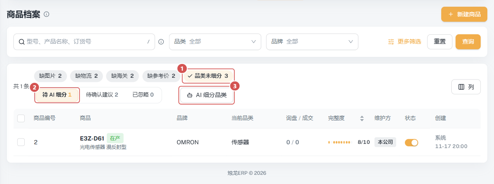
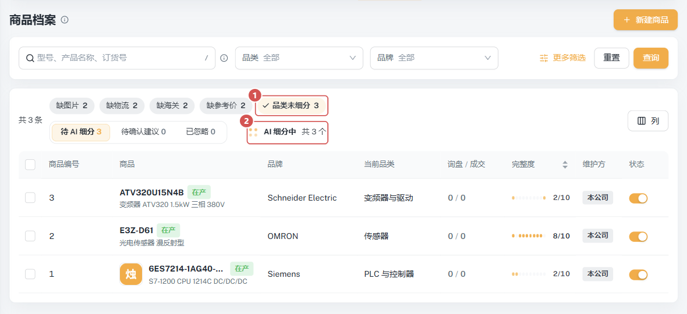
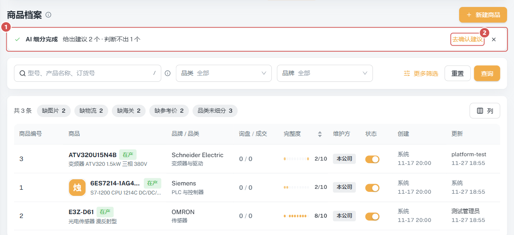
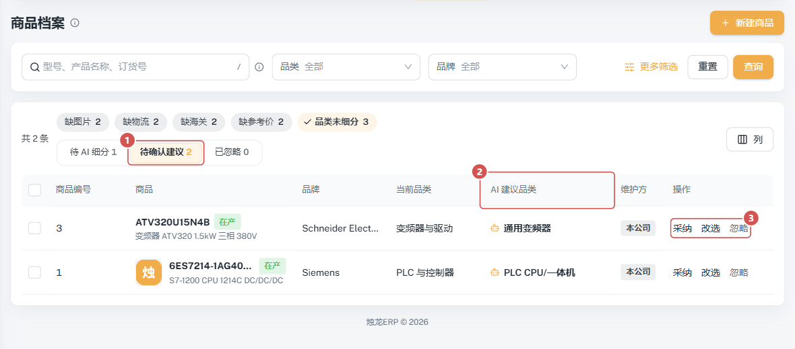
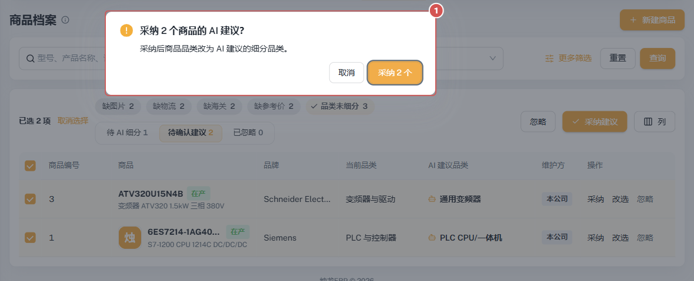
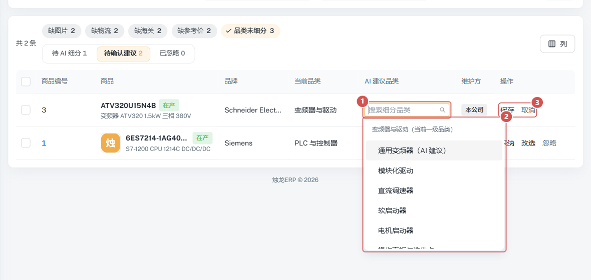

# 商品品类细分使用手册

> **给谁看**：维护商品档案的员工、采购员、供应链负责人  
> **适用版本**：界面改造（ui-redesign）上线后的版本  
> **文档版本**：V1.0  
> **最近更新**：2026-11-27  
> **截图来源**：本机测试环境实际页面（浅色、1440 宽）；AI 的运行状态和建议是为截图造的演示数据，截完已还原

## 先看这一页：品类细分是做什么的？

商品的品类分两级，例如「PLC 与控制器 → PLC CPU/一体机」。很多商品当初只选了一级品类，或者放在「其他」里。这样的商品：

- 在供应链里会显示成「未分类」，进不了按品类统计的覆盖矩阵和供应商开发清单；
- 按品类筛选、看报表时会漏掉。

品类细分就是把这些商品补到二级品类。商品多的时候不用一个个查：交给 AI 先给建议，你只需要看一眼，采纳、改选或忽略。

### 三档进度

| 档位 | 是什么 | 你要做的 |
| --- | --- | --- |
| 待 AI 细分 | 只有一级品类、或在「其他」里，还没让 AI 看过的商品 | 点 **AI 细分品类** 交给 AI |
| 待确认建议 | AI 已给出建议、等人确认的商品 | 采纳 / 改选 / 忽略 |
| 已忽略 | 你判断暂时不细分的商品 | 需要时撤销忽略 |

## 目录

1. 找到品类未细分的商品
2. 交给 AI 细分
3. 确认 AI 建议：采纳、改选、忽略
4. 完成后会发生什么
5. 常见问题与速查表

## 1. 找到品类未细分的商品

左侧菜单进入：**商品管理 → 商品档案**。

*图 1：① 表格上方「档案缺项」里点 **品类未细分**；② 下面出现三档，默认停在「待 AI 细分」，数字是本公司能看到的商品数；③ 右边是 **AI 细分品类** 按钮。*

1. 点 **品类未细分**。
2. 默认停在 **待 AI 细分**。当前品类是「其他」的显示成橙色标签。
3. 可以再配合品类、品牌、搜索缩小范围，例如只看「Siemens」。

## 2. 交给 AI 细分

### 2.1 按步骤操作

1. 在 **待 AI 细分** 里，想处理哪些就勾选哪些；不勾选就按当前筛选处理。
2. 点右侧 **AI 细分品类**。
3. 弹窗里看清本次处理多少个，点 **开始细分**。

**注意**：

- 一次最多 200 个。不勾选时，超过 200 个会先跑最近更新的 200 个，其余下次再跑。
- 只处理 **本公司维护** 的商品。别家公司维护的商品会被跳过，计入「跳过」。

### 2.2 运行中

*图 2：① 点开的「品类未细分」；② 原来的按钮位置变成「AI 细分中 共 N 个」。AI 在后台跑，可以离开页面，回来还能看到进度。*

同一个人同时只能跑一批，上一批跑完才能再发起。

### 2.3 跑完了

*图 3：① 跑完后页头下方出现「AI 细分完成 给出建议 X 个 · 判断不出 Y 个」（有跳过的还会写「跳过 N 个」）；② 点 **去确认建议** 进入下一步，点右边 × 可以关掉这条提示。*

- **判断不出**：AI 没把握的商品，留在「待 AI 细分」，需要人工到商品详情里选品类。
- **跳过**：别家公司维护的商品，以及运行期间品类已经被人改过的商品。

## 3. 确认 AI 建议：采纳、改选、忽略

点 **待确认建议**。

*图 4：① 「待确认建议」这一档；② 「AI 建议品类」列是 AI 给的细分品类，带橙色「改一级品类」标签的，表示建议的品类不在商品现在的一级品类下，要多看一眼；③ 每行的 **采纳 / 改选 / 忽略**。询盘次数、建议时间收在表格右上角的「列」里，需要时勾上。*

### 3.1 采纳

- 单个：点该行 **采纳**。
- 批量：勾选多行，点上方 **采纳建议**。

*图 5：① 勾选后点 **采纳建议** 弹出的确认，写明要采纳几个；其中有会改一级品类的，会单独写出数量。不确定的先取消勾选，再逐个改选。*

### 3.2 改选

AI 建议不对时，点该行 **改选**，在下拉里选正确的细分品类，点 **保存**。

*图 6：① 点 **改选** 后，「AI 建议品类」这一格变成可搜索的下拉；② 当前一级品类下的细分品类排在最前，AI 建议的那个标「（AI 建议）」；③ 选好后点 **保存**，不改了点 **取消**。*

### 3.3 忽略

商品暂时不想细分（例如型号信息不全），点 **忽略**。忽略的商品进 **已忽略**，那里的 **撤销忽略** 能把它放回「待 AI 细分」。

### 3.4 填写示例

| 型号 | 当前品类 | AI 建议 | 怎么处理 |
| --- | --- | --- | --- |
| 6ES7 214-1AG40-0XB0 | PLC 与控制器 | PLC CPU/一体机 | 对，点 **采纳** |
| 6SL3210-1KE21-3UF1 | PLC 与控制器 | 通用变频器（改一级品类） | 这是变频器，原一级品类选错了，点 **采纳** |
| AS228P-A | PLC 与控制器 | I/O 模块 | 这是 PLC 主机，点 **改选** → 选「PLC CPU/一体机」 |

## 4. 完成后会发生什么

- 商品品类改成细分品类，离开「品类未细分」，三档数字随之减少。
- 供应链里同品牌、同型号、还显示「未分类」的型号，会自动补上这个品类：你所在公司的立即补上，其余每天早上的自动任务补上。补上的型号会进入覆盖矩阵和供应商开发清单。
- 型号详情的操作记录里会多一条「品类：未分类 → X（按商品主数据）」，操作人是「系统」。

## 5. 常见问题与速查表

### 常见问题

**问：点「AI 细分品类」提示「AI 未配置」或「AI 暂不可用」？**  
答：需要先在 **业务设置 → AI 设置** 里配置 AI。没有这个菜单的，请找管理员。

**问：为什么「待 AI 细分」里有些商品不能勾选、操作列显示「只读」？**  
答：这些商品由其他公司维护，只能查看，不能改品类。

**问：采纳时提示某些商品被跳过？**  
答：弹出的清单会逐条写原因，常见的有：品类已被修改（别人先改了）、该商品由其他公司维护、建议的品类已停用、品类已细分。

**问：AI 跑完以后，我又在商品详情里改了品类，AI 建议还在吗？**  
答：不在了。商品品类一改，原来的 AI 建议就作废，避免把旧建议采纳到新品类上。

**问：要不要把所有商品一次细分完？**  
答：不用。建议先从供应链里「未分类」多的品牌开始，每次 200 个，分几天做完。

### 速查表

| 我要…… | 去哪里 | 点什么 |
| --- | --- | --- |
| 找只有一级品类的商品 | 商品档案 | 品类未细分 |
| 让 AI 给建议 | 品类未细分 → 待 AI 细分 | AI 细分品类 |
| 确认建议 | 品类未细分 → 待确认建议 | 采纳 / 改选 / 忽略 |
| 把忽略的放回去 | 品类未细分 → 已忽略 | 撤销忽略 |

### 需要的权限

| 权限 | 能做什么 |
| --- | --- |
| 商品档案（菜单） | 打开商品档案、看三档数字 |
| 编辑商品 | 发起 AI 细分、采纳、改选、忽略、撤销忽略 |
